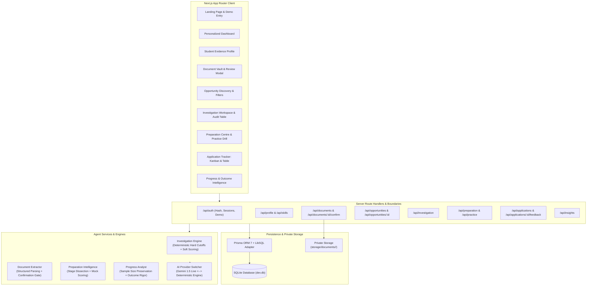
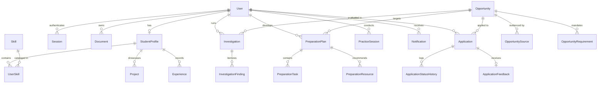

# System Architecture & Technical Design
## Opportunity Intelligence Agent | Devlympics 2026 | NSUT

This document outlines the technical architecture, domain models, service boundaries, and security safeguards of the Opportunity Intelligence System.

---

## 1. High-Level Architecture Overview

---

## 2. Core Service Boundaries

### A. Authentication & Session Boundary (`src/lib/auth.ts`)
- **Password Security:** Uses `bcryptjs` with salt rounds = 10.
- **Session Tokens:** Cryptographically random 32-byte hex tokens stored in the `Session` table.
- **Cookie Security:** Issued as `httpOnly: true`, `sameSite: "lax"`, `path: "/"`, and `secure: true` in production.
- **Access Control:** `getCurrentUser()` and `requireAuth()` validate session validity and expiration before any user resource is accessed.
- **Demo Mode Isolation:** A dedicated demo student account (`priya.sharma@nsut.ac.in`) allows instant, safe evaluations without exposing private student credentials.

### B. Student Evidence Profile Boundary (`src/app/api/profile`, `src/app/api/skills`, `src/app/api/projects`)
- Separates self-reported skills from verified credentials.
- Binds skills to concrete proof links (GitHub repositories, LeetCode profile, marksheet transcripts).
- Calculates a dynamic profile completeness score based on verified dimensions.

### C. Document Vault & Confirmation Gate (`src/app/api/documents`)
- Files are saved outside public static assets in `storage/documents/<userId>/`.
- Text is extracted and passed to `extractResumeData()`.
- **Strict Rule:** Extracted data is saved with `isConfirmed: false` in an unconfirmed JSON buffer. It only updates the student's profile once the user has reviewed and submitted the **Extraction Review Modal**.

### D. Opportunity Investigation Engine (`src/lib/ai/investigator.ts`)
1. **Retrieve:** Fetches the opportunity, its official sources, and published requirements.
2. **Deterministic Evaluation:**
   - Evaluates graduation batches: `eligibleGradYears.includes(studentGradYear)`.
   - Evaluates academic cutoffs: `studentCgpa >= minCgpa`.
   - Evaluates mandatory skills: Checks verified skills and project repositories.
3. **Evidence Classification:**
   - `SATISFIED`: Clear proof link or confirmed project repository.
   - `NOT_SATISFIED`: Unmet published cutoff (e.g. batch mismatch).
   - `NEEDS_CONFIRMATION`: Self-reported skill without repository evidence.
   - `NO_EVIDENCE_FOUND`: Missing from student profile (explicitly distinguished from failed).
   - `AMBIGUOUS_SOURCE`: Opportunity text is vague.
4. **Overall Status Decision Tree:**
   - Failed mandatory cutoff $\rightarrow$ `LIKELY_INELIGIBLE` (capped score $\le 35$).
   - All mandatory criteria satisfied with verified evidence $\rightarrow$ `APPEARS_ELIGIBLE`.
   - Missing mandatory evidence $\rightarrow$ `POTENTIALLY_ELIGIBLE`.
   - Missing critical data from both sides $\rightarrow$ `INSUFFICIENT_INFORMATION`.

### E. Preparation Intelligence Engine (`src/lib/ai/preparation.ts`)
- Synthesizes opportunity-specific roadmaps based on required tech stacks.
- Labels every stage with its evidence basis:
  - `OFFICIAL_STAGE`: Stated on employer career portal.
  - `CANDIDATE_REPORTED`: Historical candidate experience.
  - `AI_INFERRED`: Logical preparation recommendation.
- Provides interactive mock drills with instant structured evaluation (strengths, improvements, score estimate).

### F. Application & Outcome Intelligence (`src/lib/ai/progress.ts`)
- Manages the complete hiring lifecycle: `SAVED` $\rightarrow$ `PREPARING` $\rightarrow$ `APPLIED` $\rightarrow$ `ASSESSMENT_SCHEDULED` $\rightarrow$ `INTERVIEW_SCHEDULED` $\rightarrow$ `OFFER_RECEIVED` / `REJECTED`.
- Every transition appends an immutable audit log to `ApplicationStatusHistory`.
- Feedback is recorded with source attribution (`EMPLOYER_EMAIL`, `INTERVIEWER_NOTES`, `PORTAL_MESSAGE`).
- If no reason was given, the system records `Unknown` and explicitly warns against speculative assumptions.
- Analytics compute the conversion funnel and preserve sample size ($n=x$).

---

## 3. Database Schema Design (Prisma ORM)

---

## 4. AI Provider & Fallback Strategy

The application implements a provider-independent AI interface (`src/lib/ai/gemini.ts`):
- When `GEMINI_API_KEY` is present and valid, calls Google Gemini 1.5/2.0 with temperature $0.2$ and JSON structured schema validation.
- When `GEMINI_API_KEY` is missing or when a rate limit / network timeout occurs, the system seamlessly transitions to our deterministic rule engine.
- Every investigation report and the top navbar explicitly indicate which engine generated the findings (`GEMINI_LIVE` vs `DEMO_DETERMINISTIC`).

---

## 5. Security & Trust Measures

- **No Frontend AI Calls:** API keys and external model invocations are 100% server-side.
- **Input Sanitization:** Every API endpoint validates payloads via `zod` schemas.
- **Path Traversal Protection:** Stored document file paths are sanitized with timestamps and UUID-style naming.
- **Access Control:** All mutating actions verify `userId` matching the authenticated session.
